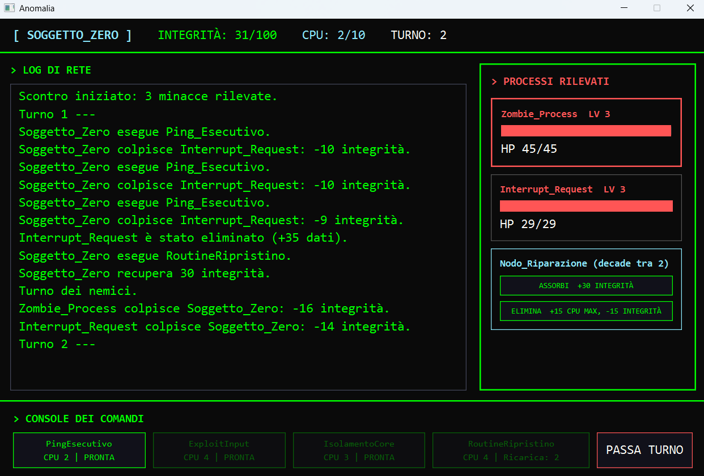

# 📌 Anomalia

**Anomalia** è un gioco di ruolo a turni ambientato all'interno di una rete informatica. Il giocatore controlla **Soggetto Zero**, un'intelligenza artificiale che esplora mappe a nodi affrontando processi ostili fino allo scontro con il boss finale.





## 🚀 Come eseguire il progetto

### Prerequisiti

- Java 25 (LTS)
- Gradle
### Istruzioni

```
git clone https://github.com/filippodinaso/Anomalia/
```

### Build del progetto

```
./gradlew build
```

### Esecuzione

```
./gradlew run
```

---

## 🤖 Uso di strumenti di AI

L’AI è stata utilizzata come supporto allo studio, alla code review, alla revisione dei commenti e alla documentazione del progetto.

- Utilizzati ChatGPT e Gemini per:


    - comprendere e chiarire concetti teorici;
    - supporto nell'individuazione di bug;
    - trovare spunti per i nomi dei contenuti del gioco;
    - supporto nella revisione commenti.
- Utilizzato Claude per:


    - consultare e chiarire la teoria del corso, in particolare sui design pattern e sulle best practice;
    - generare codice ripetitivo;
    - chiarire errori di compilazione.
---

## ⚠️ Nota

L'estendibilità del gioco è trattata all'interno della wiki.